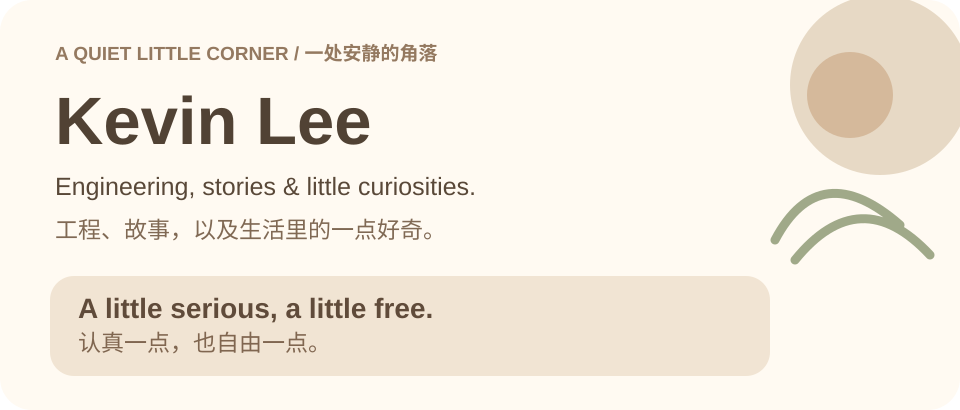
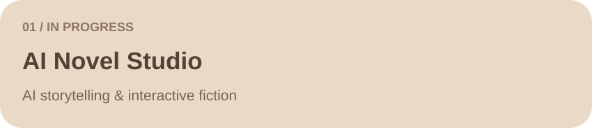
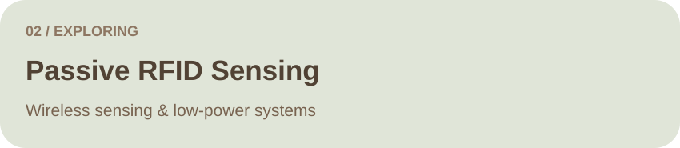
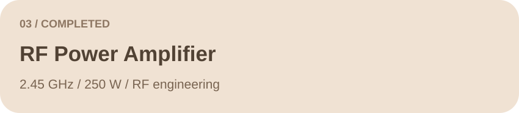

### 🌿 About Me / 关于我

Hi, I'm **Kevin**, an engineering student at **Xidian University**. I'm curious about how things work, from circuits and embedded systems to software and creative tools. I enjoy exploring ideas and turning some of them into something real.

你好，我是 **Kevin**，来自**西安电子科技大学**。对电路、嵌入式系统、软件和创作工具都有兴趣。喜欢理解事物如何运转，也喜欢把一些想法变成现实。

### 📚 Things I'm Making / 正在做的事

> Project links will be added when public repositories are ready.  
> 项目公开仓库准备好后再添加链接。

### ♡ Little Things I Like / 喜欢的事物

| | |
|:---|:---|
| 🎮 **Strategy Games** · 策略游戏 | ♫ **Music** · 音乐 |
| 📖 **Literature & Stories** · 文学与故事 | 🌱 **Social Sciences** · 社会科学 |
| ⚙️ **Technology** · 技术与创造 | ☁️ **Quiet Moments** · 安静的时光 |

### ✦ A Little Activity / 一些足迹

*Thanks for stopping by.*  
*谢谢你来过。*

